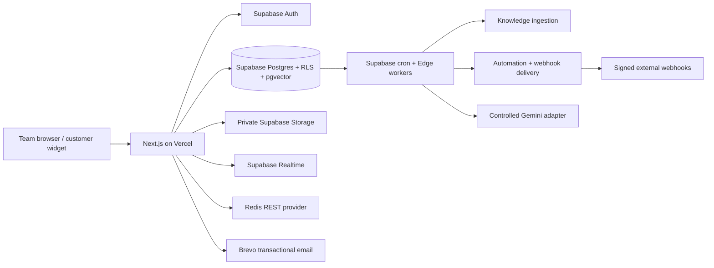
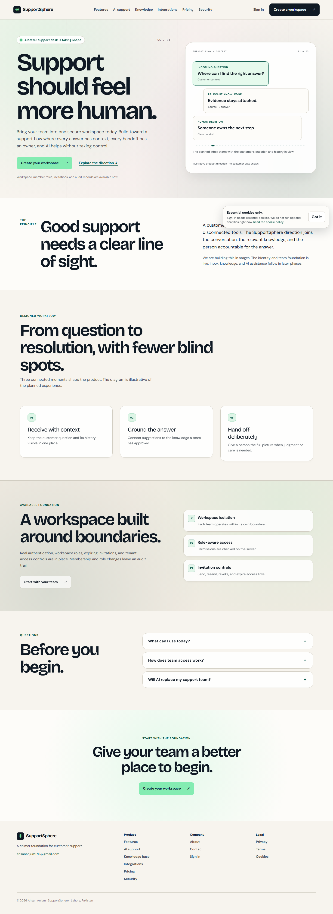

# SupportSphere

SupportSphere is a production-shaped, multi-tenant customer-support workspace for teams that want customer context, approved knowledge, durable workflows, and human-controlled AI in one place. The product is a portfolio deployment, but its core paths use real Supabase Auth/Postgres/RLS/Storage/Realtime records rather than UI fixtures.

**Production origin:** [support-sphere-psi.vercel.app](https://support-sphere-psi.vercel.app/)

> Release status: P13 deployment proof is in progress. Supabase production is healthy and the public Vercel origin is reachable. The final release gate still depends on owner-controlled credential rotation, Vercel environment parity, and the Gemini provider quota gate recorded in `.agent/MANUAL_ACTIONS.md`.

## What is implemented

- Workspace creation, onboarding, roles, invitations, audit records, password recovery, and Google OAuth through Supabase Auth.
- Tenant-scoped customers, conversations, messages, internal notes, tickets, tags, realtime inbox updates, and widget sessions.
- Private knowledge sources with durable ingestion, deterministic chunking, embeddings, retry/recovery, and pgvector retrieval.
- A bounded AI state machine with triage, evidence gates, quality checks, citations, human handoff, feedback, and persisted run traces. AI is disabled for the public demo until real Gemini quota verification passes.
- Database-owned automations, durable job state, Redis-compatible rate limits/locks/cache, and signed outgoing webhooks with retries and idempotency.
- Real workspace analytics and evidence-bound evaluation records. Optional marketing analytics is intentionally disabled and the cookie notice says so.
- Responsive editorial marketing pages, accessible auth/workspace surfaces, a strict cross-origin widget loader, security headers, robots, sitemap, and a branded 404.

## Architecture



A Vercel request never acts as an always-on worker. Postgres owns relational truth, RLS and role checks protect every tenant boundary, Redis is ephemeral coordination only, and Edge workers claim durable jobs with bounded retries. Retrieved knowledge is untrusted input; the AI path has no arbitrary SQL, shell, or outbound customer-chosen tools.

## Stack

- Next.js 16 App Router, React 19, TypeScript strict mode, Tailwind v4, Zod, Motion.
- Supabase Auth, Postgres 17, RLS, Storage, Realtime, pgvector, and scheduled Edge Functions.
- Redis REST adapter compatible with Upstash-style commands for scoped rate limits, locks, cache, and idempotency.
- Brevo Transactional API and Supabase custom SMTP for application/auth email.
- Google Gemini `generateContent` adapter with runtime-validated structured output (provider verification remains a release gate).
- Vercel production deployment; Stripe test mode and optional analytics are deliberately unselected.

## Local setup

Use Node.js 22.17+ and pnpm 11.25.0.

```sh
pnpm install --frozen-lockfile
cp .env.example .env.local
pnpm dev
```

Only public Supabase values belong in `NEXT_PUBLIC_*`. Keep service credentials, Brevo, Redis, job, AI, OAuth, and Stripe secrets in ignored local files or provider secret stores. The app validates provider variables at their server boundary; missing optional integrations fail closed instead of fabricating a connected state.

Run the repository checks:

```sh
pnpm typecheck
pnpm lint
pnpm format:check
pnpm test
pnpm test:e2e
pnpm build
```

## Supabase migrations and generated types

The repository uses imperative, versioned migrations. Apply them to the intended project with the project ref and credentials kept outside chat/source:

```sh
npx supabase db push --db-url "$SUPABASE_DB_URL"
npx supabase gen types typescript --project-id xviumgygixcklrbuynoh > lib/supabase/database.types.ts
```

The current SupportSphere project is `xviumgygixcklrbuynoh` in `ap-south-1`. Its production inspection on 2026-10-12 reported `ACTIVE_HEALTHY`, migrations through P11 trigger hardening, 39 public tables with RLS enabled, and active knowledge, AI, automation, and webhook cron workers. Review migrations and Supabase security/performance advisors after every schema change.

## Demo seed

`pnpm seed:demo` runs [scripts/seed-demo.mjs](scripts/seed-demo.mjs) against the actual Supabase project. It creates or reuses an explicitly named demo owner/workspace, configures the widget origin, creates a customer/conversation/messages/ticket through the real Auth/RPC paths, and queues a real paste source through the knowledge ingestion pipeline. It is idempotent for the named workspace and refuses to run without an explicit `ALLOW_DEMO_SEED=1` guard.

Create an ignored `.env.demo.local` or export these values in a private shell, then run with Node's env-file support:

```sh
$env:ALLOW_DEMO_SEED='1'
node --env-file=.env.demo.local scripts/seed-demo.mjs
```

Required seed-only variables are `DEMO_OWNER_EMAIL`, `DEMO_OWNER_PASSWORD`, `DEMO_WORKSPACE_SLUG` (format `ss-demo-*`), and `DEMO_WEBSITE_ORIGIN` (the exact HTTPS origin where the widget is embedded). The script does not seed an AI answer, analytics number, or fake integration state. After the source reaches `ready`, run the deployed golden journey against the real records.

## RAG and AI graph

```text
customer message
  -> deterministic triage
  -> sensitive/policy gate
  -> workspace-scoped pgvector retrieval
  -> bounded structured draft
  -> citation + confidence/evidence checks
  -> quality gate
  -> send, draft, or human handoff
```

The graph persists each run, step, citation, decision, failure code, and feedback row. Knowledge documents are untrusted context and cannot authorize tools. The demo workspace stays in `off` mode until the Gemini project/model/quota is verified with synthetic fixtures.

## Security architecture

Every tenant table has RLS and workspace-scoped foreign keys/indexes. Server actions re-check the authenticated actor and workspace role; viewers cannot mutate support or configuration data. Service-role credentials never enter browser code. Password/reset/invitation tokens are handled through scoped callbacks, webhook deliveries use HMAC signatures and replay-safe event identity, URL ingestion rejects unsafe destinations, uploads are bounded/private, and provider errors are reduced to safe codes. Supabase advisors are reviewed in `.agent/QA.md`.

## Portfolio golden journey

The release proof is recorded in `.agent/QA.md` and follows:

`landing → signup/login → onboarding → knowledge ingestion → external widget → customer message → realtime inbox → AI evidence/draft or reply → sensitive escalation → human response → ticket → analytics`

The public route, SEO, responsive, accessibility, role, widget, knowledge, automation, webhook, and analytics suites already run against real local-build or Supabase fixtures. P13 still requires a fresh deployed run after environment rotation and Gemini provider verification; no fabricated AI success is reported.

## Provider and free-tier notes

- Supabase is the production data/auth platform. Keep preview and production data separate where possible.
- Supabase cron plus Edge Functions provide the durable scheduled workers; job state, retries, leases, and terminal errors live in Postgres.
- Redis is optional for some fallbacks but required for the strict protected buckets when configured; it is never canonical data storage.
- Brevo sender verification and Supabase custom SMTP must remain configured for real invitation/reset delivery.
- Gemini free-tier quotas and model availability change. Provider limits are not encoded as product truth; real AI traffic remains disabled until the manual gate passes.
- Stripe is not selected for this release. Analytics is off by owner choice and no non-essential tracking runs.
- The assigned Vercel hostname is the current public origin; a custom domain, operator identity, and legal text require owner control and review.

## Limitations

URL/DOCX knowledge inputs are intentionally unavailable until their parser and SSRF/content validation paths are implemented. AI provider output is not guaranteed on free-tier quotas. The public portfolio does not claim compliance certifications, paid billing, Slack, or a production custom domain. See `.agent/STATE.md`, `.agent/MANUAL_ACTIONS.md`, and `.agent/HANDOFF.md` for current release state.

## Screenshots

The reviewed production landing-page capture below comes from the recorded Vercel origin. The browser smoke covers the landing page, auth, workspace routes, widget fallback, mobile menu, focus, and overflow at 320/360/390/768/1024/1440px. Do not use fabricated product imagery.



## Reference acknowledgments

The [500 AI Agents Projects](https://github.com/ashishpatel26/500-AI-Agents-Projects) repository and its customer-support example were consulted for workflow/RAG ideas only. SupportSphere keeps its own Postgres/pgvector, RLS, retry, and human-gate architecture and imports no upstream secrets or demo assumptions. The visual language adapts the Command Center DesignMD reference and the project records source/license notes in [DESIGN.md](DESIGN.md).

## Agent release records

- [Complete verification runbook](docs/verification-runbook.md)
- [P13 state](.agent/STATE.md)
- [Verification matrix](.agent/QA.md)
- [Manual owner actions](.agent/MANUAL_ACTIONS.md)
- [Architecture decisions](.agent/DECISIONS.md)
- [Session handoff](.agent/HANDOFF.md)
